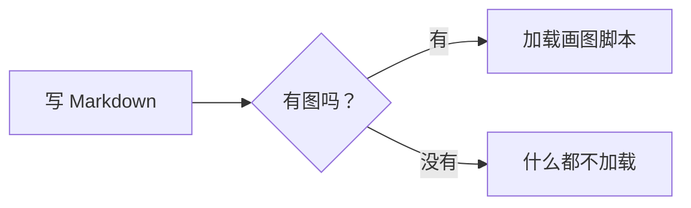

这一页把正文里会用到的东西都渲染一遍。以后改字号、行高、段距、颜色或引用框，先来这里看一眼，就知道有没有把哪个元素弄坏。

它不是给读者看的文章，是给这个站自己看的「样本页」。

## 标题

页面最上面的「样式」是 H1。正文里的分节标题是 H2，也就是你现在看到的这一行。下面是更小的几档：

### 三级标题（H3）

这一行是 H3，用来切分 H2 下面的小节。正文仍然是 17px，标题只靠字号和间距拉开层级。

#### 四级标题（H4）

这一行是 H4。再往下还有 H5 和 H6，但长文里很少用到。

##### 五级标题（H5）

这一行是 H5。

###### 六级标题（H6）

这一行是 H6，已经和正文差不多大，只靠加粗和上间距区分。

## 正文

中文正文的样子：行高 1.8（30.6px），段间距 32px。中文、English、数字 12345 混排时，标点和空格都按现在这套规则走。

这一段的末尾有一个**加粗**、一个*斜体*、一段~~删除线~~、一处==高亮==、一个`行内代码`、一组按键 <kbd>⌘</kbd> <kbd>K</kbd>，还有一条[站内链接](/about/)和一条[站外链接](https://www.w3.org/)。链接颜色全站只有一个蓝，访问过也不会变紫。

## 中文排版

这一段在源文件里是折成两
行写的，渲染出来应该连成一句，「两」和「行」之间没有空格。

链接紧挨着全角标点时两边不留空格，比如这条指向[关于页](/about/)的链接，以及括号里的（[站点地图](/map/)）。

中英文之间平时手打一个空格，比如「用 Hugo 写博客」。下面这句故意没加：用Hugo写博客，2026年开始。在支持自动间距的浏览器里，「用」和「Hugo」、「2026」和「年」之间会多出一点空，但比手打的空格窄。

命令和参数放进行内代码：`vsub 视频.mp4 --burn`。不放进代码时，两个短横线会被排版扩展换成一个短破折号：--burn。

## 引用

> 总得留下点什么吧。——胡拉图

上面是单段引用。下面是多段引用，用来检查引用框内部的段落间距：

> 第一段引用文字。引用框有主色竖线、浅色底和左上角的引号。
>
> 第二段引用文字。两段之间应该留出一点空隙，而不是粘成一整块。

引用里再套一层：

> 外层引用。
>
> > 内层引用：检查两层竖线和底色叠在一起时是否还分得清。

## 提示框

提示框用 GitHub 的写法：引用块第一行写 `[!类型]`，类型后面跟文字就是自定义标题。五种类型各有一个颜色，没写 `[!类型]` 的引用块仍是上面的普通引用。

> [!NOTE]
> 说明：补充背景，读者可以跳过。

> [!TIP]
> 提示：更好用的做法。

> [!IMPORTANT]
> 重要：读者需要知道的关键信息。

> [!WARNING]
> 注意：可能出问题的地方，比如这个操作会连安全补丁一起屏蔽。

> [!CAUTION] 先备份再操作
> 警告：不可逆、可能造成损失的操作。这一条用了自定义标题。

可折叠的提示框：类型后面跟 `-` 默认收起，跟 `+` 默认展开（Obsidian 的写法，GitHub 上会显示成普通引用）。

> [!TIP]- 点开看提示
> 收起时只露出标题，点标题展开。

> [!NOTE]+ 默认展开的一条
> 跟 `+` 的一开始就是展开的，也可以点标题收起。

## 列表

无序列表：

- 第一项
- 第二项
  - 嵌套项
  - 另一个嵌套项
- 第三项

有序列表：

1. 第一项
2. 第二项
3. 第三项

任务列表：

- [x] 已经做完的一项
- [ ] 还没做的一项
- [ ] 另一项

定义列表（术语单独一行，解释另起一行、用冒号开头）：

行高
: 一行文字占的高度。本站正文是 1.8，也就是 30.6px。

段距
: 段落之间的距离，32px，比行盒略大一点。

## 表格

| 项目 | 值 | 说明 |
| --- | --- | --- |
| 正文 | 17px | 所有阅读页统一 |
| 行高 | 1.8 | 行盒 30.6px |
| 段距 | 32px | 比行盒略大 |

列对齐（左 / 居中 / 右），右对齐的数字列应该按位对齐：

| 左对齐 | 居中 | 右对齐 |
| :--- | :---: | ---: |
| 第一行 | 文字 | 1,024 |
| 第二行 | 更长一点的文字 | 8 |

## 代码

行内代码写作 `const answer = 42`，背景是次级底色，等宽字体。

代码块：

```js
function hello(name) {
  console.log(`Hello, ${name}!`);
  return true;
}

// 中文注释：这是一个问候函数
const greeting = "你好，世界！";
```

标出某几行、显示行号：在语言后面写 `{linenos=true,hl_lines=[2]}`。复制按钮不会把行号一起复制。

```js {linenos=true,hl_lines=[2]}
function add(a, b) {
  return a + b; // 这一行被标出来了
}
```

## 数学公式

行内公式写在 `\(` 和 `\)` 之间：质能方程 \(E = mc^2\)，勾股定理 \(a^2 + b^2 = c^2\)。

独立成行的公式用 `$$` 包住（也可以用 `\[` 和 `\]`），居中显示：

$$
x = \frac{-b \pm \sqrt{b^2 - 4ac}}{2a}
$$

公式在构建时就排成了 MathML，页面上不加载任何脚本。写错了（比如少一个括号）构建会失败，并指出是哪个文件、哪一行。

## 图表

代码块的语言写 `mermaid`，就会画成图：流程图、时序图、甘特图都可以，颜色跟着深浅色切换。只有用到图的页面才加载画图脚本（约 1 MB）。



## 链接与脚注

链到站内别的页面时，可以直接写它的文件名，比如[站点地图](map.md)，构建时会换成正式网址。

这是一个脚注示例[^1]。点编号会在旁边弹出脚注，再点一次或按 Esc 收起；用鼠标的话停在编号上一会儿也会弹出，移开就收起，悬停弹出时点一下就钉住不收。按住 ⌘ / Ctrl 点仍然跳到文末。第二条脚注里有链接[^2]。

[^1]: 脚注文字是 16px、二级灰。点正文里的编号就地弹出；从文末这里点 ↩︎ 回到正文，跳过来时这一条会高亮一下。
[^2]: 脚注里也可以有链接，比如 [W3C](https://www.w3.org/)，在弹层里照样能点。

## 折叠块

<details>
<summary>点击展开</summary>
<p>折叠块里的内容。它适合放不重要的补充说明，或者很长但不必默认展示的清单。</p>
</details>

## 图片与图注

正文里的图片都用 Markdown 写法、单独占一行。alt 文字同时是下面的图注；点图片可以放大。


在网址后面的引号里写了标题时，图注改用标题，alt 只留给读屏和图片加载失败的时候：


## 分隔线

下面是分隔线：

---

分隔线上方和下方各留一段距离，用来切开两个不相关的小节。
